# Le module TiBillet : l'installer et le régler

Ce guide installe le module TiBillet dans Dolibarr, **une seule fois**, quel que soit le
mode choisi. Pas besoin d'être informaticien : on avance pas à pas, avec des images.

📖 Avant de commencer, lisez le guide [Un plan comptable](01-un-plan-comptable.md) : il
explique les mots « compte », « journal », « débit » et « crédit ».

## 1. Deux façons de travailler : choisissez un mode

Le module envoie TiBillet dans Dolibarr de **l'une** de ces deux façons :

- 🧾 **Les articles et les ventes** (le mode par défaut) : chaque matin, le catalogue de
  TiBillet devient des produits Dolibarr, et chaque vente une **facture payée**.
  Dolibarr tient la comptabilité avec ses propres factures. Guide :
  [Remontée des ventes et articles](03-articles-et-ventes.md).
- 📚 **Les écritures comptables** : chaque matin, les écritures des journées clôturées
  vont dans le **grand livre** de Dolibarr, exactement comme le fichier FEC. Pas de
  facture. Guide : [Comptabilité (partie double)](02-relier-tibillet-a-dolibarr.md).

⚠️ **Un seul mode à la fois.** Avec les deux, chaque vente serait comptée deux fois.

Dans les deux cas, Dolibarr ne travaille **jamais en temps réel** : il ne lit que les
journées déjà clôturées (le « Z » du soir).

## 2. Ce qu'il vous faut

- ☑️ Un **Dolibarr** en version 24 ou plus (le module est essayé avec Dolibarr 24.0.1),
  et un compte **administrateur** dans ce Dolibarr.
- ☑️ Un accès **administrateur** à votre lieu TiBillet.
- ☑️ Un **plan comptable complet** dans TiBillet : le bouton « Vérifier le plan » donne
  un message vert (voir le guide [Un plan comptable](01-un-plan-comptable.md)).
- ☑️ Les **tâches planifiées** de Dolibarr (le « cron ») doivent tourner : ce sont elles
  qui lancent l'import chaque matin. Si Dolibarr est chez un hébergeur, demandez-lui. On
  en reparle à l'étape 7.

## 3. Côté TiBillet : créer une clé d'API

La clé, c'est le mot de passe que Dolibarr donne à TiBillet. Elle ne permet que de
**lire** : Dolibarr ne peut rien modifier dans TiBillet.

1. Dans l'administration de votre lieu TiBillet, ouvrez **Paramètres**, puis
   **Clés API**, puis le bouton **+** (ajouter).
2. Donnez-lui un nom, par exemple « Dolibarr ».
3. Activez **seulement** les droits de votre mode. Laissez tous les autres éteints :
   - mode **articles et ventes** : **« Produits »**, **« Comptabilité (lecture) »** et
     **« Ventes »** ;
   - mode **écritures comptables** : **« Comptabilité (lecture) »** seul.
4. Si votre Dolibarr a une adresse IP fixe, remplissez « Ip source » : la clé ne
   marchera que depuis cette adresse.
5. Enregistrez. ⚠️ La clé s'affiche **une seule fois** : copiez-la tout de suite. Vous la
   collerez dans Dolibarr à l'étape 6.

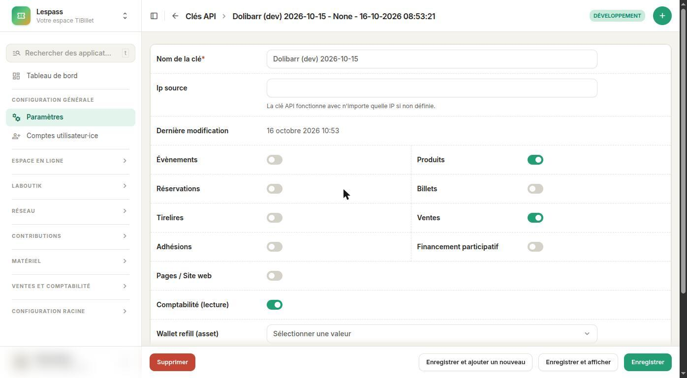

🔐 **Gardez la clé secrète.** Le droit « Ventes » donne l'**e-mail** des acheteurs. Si
vous changez de logiciel, ou si une personne qui connaissait la clé quitte le lieu :
supprimez la clé dans TiBillet, et créez-en une nouvelle.

## 4. Côté Dolibarr : préparer la comptabilité (mode écritures seulement)

🧾 **Mode « articles et ventes » : sautez cette étape.** Ce mode ne touche pas à la
comptabilité de Dolibarr. Le module « Comptabilité (partie double) » peut rester éteint.

📚 **Mode « écritures comptables »** : Dolibarr a besoin de sa comptabilité pour écrire
son grand livre. Faites les trois étapes ci-dessous.

### 4.1 Activer le module « Comptabilité (partie double) »

1. Dans Dolibarr : **Accueil → Configuration → Modules / Applications**.
2. Dans le filtre, tapez « comptabilit », puis **Rafraîchir**.
3. Cliquez sur l'interrupteur de **Comptabilité (partie double)**. Il devient vert.

⚠️ Pas « Comptabilité (simplifié) » : celle-là n'a pas de grand livre.

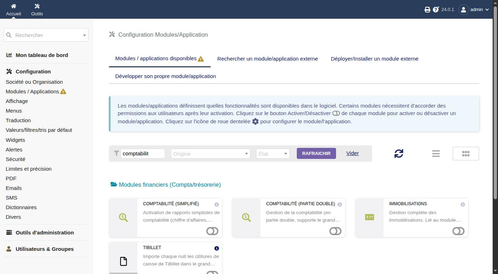

### 4.2 Charger un plan comptable

1. Menu du haut **Comptabilité**, puis à gauche **Configuration → Plan comptable**.
2. Dans « Sélectionnez le plan de compte actif », choisissez **FR - PCG18-ASSOC** si vous
   êtes une association. Sinon, le plan que votre comptable conseille.
3. Cliquez sur **Changer et charger**. Des centaines de comptes apparaissent.

💡 Les comptes de TiBillet qui n'existent pas dans ce plan seront créés par le module.

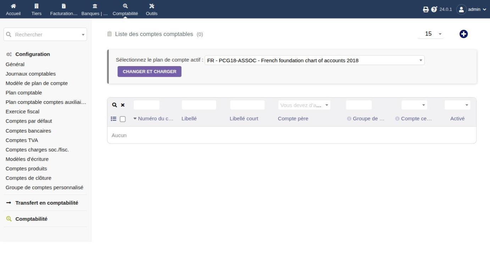

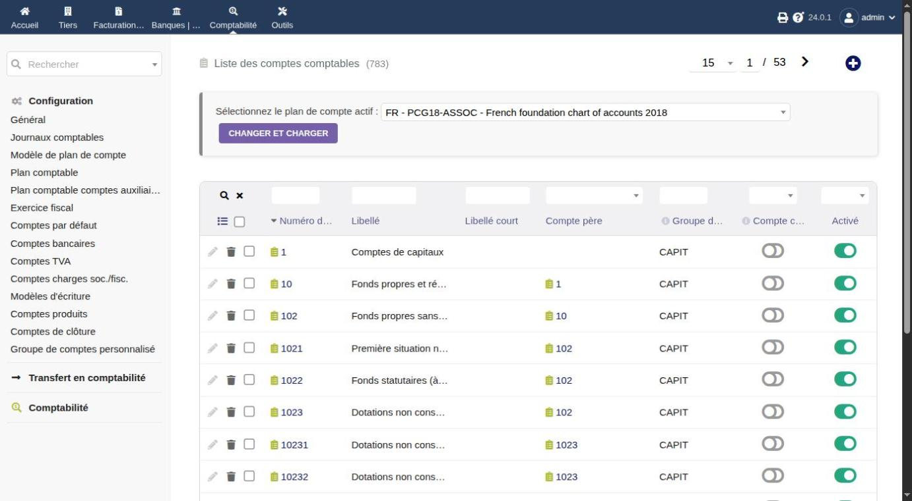

### 4.3 Ouvrir un exercice comptable

Un **exercice**, c'est l'année comptable (souvent du 1er janvier au 31 décembre). Sans
exercice ouvert, Dolibarr refuse d'écrire dans son grand livre.

1. **Comptabilité → Configuration → Exercice fiscal**, puis le bouton **+**.
2. Libellé : « Exercice 2026 ». Date début : 01/01/2026. Date fin : 31/12/2026.
3. Cliquez sur **Create**. L'exercice est « ouvert ».

📅 Chaque année, pensez à ouvrir l'exercice suivant.

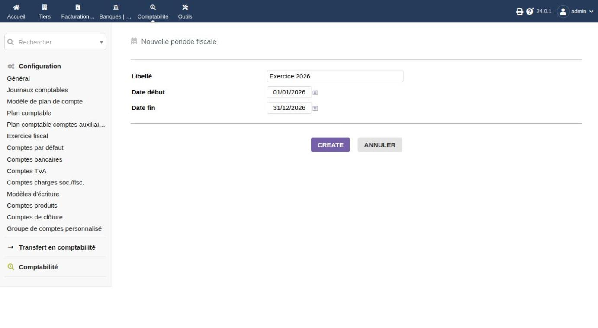

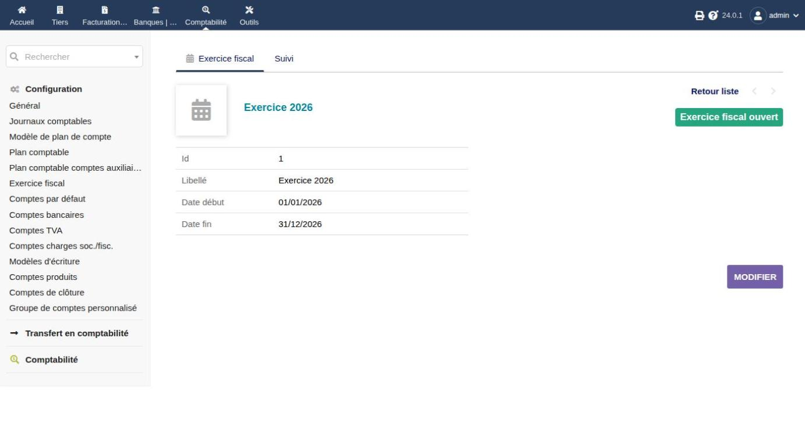

## 5. Installer le module TiBillet

### 5.1 Télécharger le module

1. Ouvrez la page des versions :
   [github.com/TiBillet/tibillet-dolibarr/releases](https://github.com/TiBillet/tibillet-dolibarr/releases).
2. Dans la version la plus récente, téléchargez le fichier **module_tibillet-….zip**
   (par exemple module_tibillet-0.2.0.zip).

⚠️ Ne prenez pas « Source code (zip) » : Dolibarr ne saurait pas l'installer. Le bon
fichier commence par **module_tibillet**.

### 5.2 Envoyer le module à Dolibarr

1. **Accueil → Configuration → Modules / Applications**, onglet
   **Déployer/Installer un module externe**.
2. **Choisir un fichier** : le zip que vous venez de télécharger. Puis
   **Envoyer fichier**.

🛠️ Si Dolibarr refuse (droits sur les fichiers, chez certains hébergeurs), demandez à
votre hébergeur de décompresser le zip dans le dossier **htdocs/custom/** de Dolibarr. Le
dossier doit s'appeler **tibillet**.

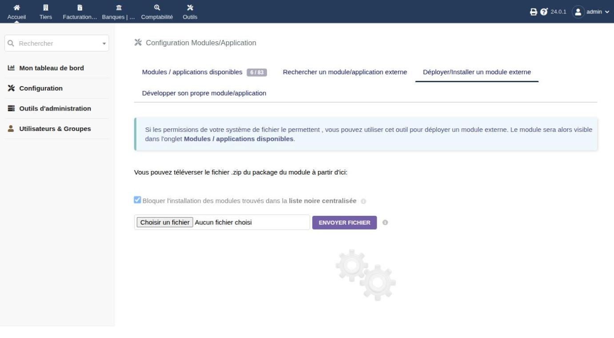

### 5.3 Activer le module

1. Onglet **Modules / applications disponibles**. Dans le filtre, tapez « tibillet »,
   puis **Rafraîchir**.
2. Cliquez sur l'interrupteur de **TiBillet**. Il devient vert, et une roue dentée
   apparaît.

✅ Dolibarr active aussi, tout seul, le module **« Travaux planifiés »** : c'est lui qui
lancera l'import chaque matin.

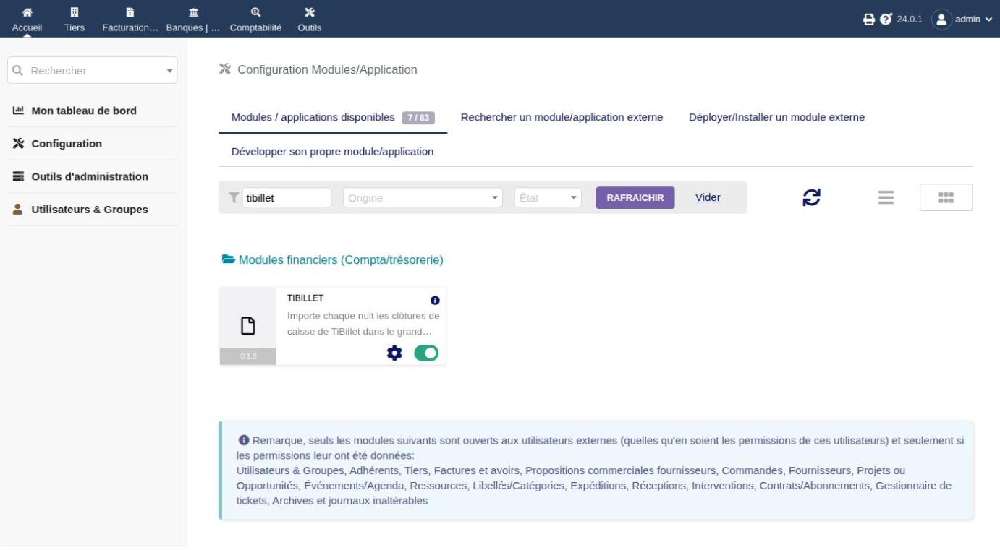

## 6. Régler le module

Cliquez sur la **roue dentée** du module TiBillet. Remplissez :

- 📒 **Ce que le module envoie dans Dolibarr** : votre mode (étape 1). Sur une nouvelle
  installation, « Les articles et les ventes » est déjà coché.
- 🕕 **Heure de la tâche de nuit** : 6 h par défaut. Choisissez une heure **après** la
  clôture automatique de TiBillet (l'heure de fermeture du lieu + 2 h).
- 🌐 **Adresse du lieu TiBillet** : l'adresse principale de votre lieu, en https. Par
  exemple `https://monlieu.tibillet.coop`.
- 🔑 **Clé d'API TiBillet** : collez la clé de l'étape 3. Après l'enregistrement, le
  champ redevient vide et affiche « Une clé est enregistrée » : c'est normal, la clé est
  chiffrée et n'est jamais réaffichée. Pour garder la clé, laissez ce champ vide.
- 🧪 **Mode développement** : laissez la case **décochée**. Elle sert seulement aux
  essais des développeurs.

Cliquez sur **Enregistrer**. En mode articles et ventes, la page active aussi les modules
de Dolibarr dont ce mode a besoin : Produits, Services, Catégories, Tiers, Factures et
Banques. En mode écritures comptables, elle active « Comptabilité (partie double) ».

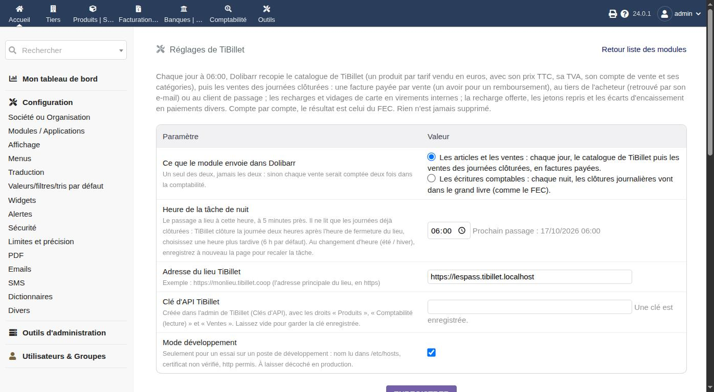

Cliquez ensuite sur **Tester la connexion**.

✅ Le message « **Connexion réussie : TiBillet donne … comptes.** » s'affiche. En mode
articles et ventes, le module vérifie aussi les droits de la clé, puis **prépare
Dolibarr** et dit ce qu'il a fait (voir le guide de ce mode).

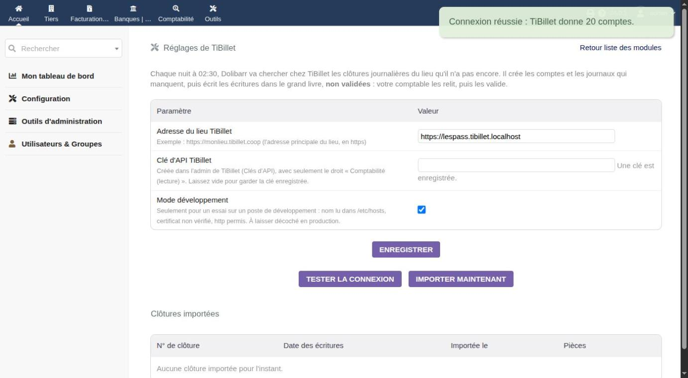

🔴 **Les messages d'erreur possibles :**

| Le message dit… | Que faire |
|---|---|
| « Clé refusée par TiBillet (403) » | La clé est fausse, n'a pas le droit « Comptabilité (lecture) », ou l'adresse IP de la clé ne correspond pas. |
| « La clé n'a pas le droit « Produits » » ou « … « Ventes » » | Dans l'admin de TiBillet, cochez ce droit sur la clé (mode articles et ventes). |
| « TiBillet est injoignable » | L'adresse du lieu est fausse, ou le serveur de Dolibarr ne peut pas sortir sur Internet. |
| « L'adresse du lieu TiBillet doit commencer par https:// » | Ajoutez https:// devant l'adresse. |

## 7. La tâche de chaque matin

Le module a créé une tâche **« Tâche de nuit TiBillet »**, programmée chaque jour à
l'heure réglée à l'étape 6. Pour la voir : **Accueil → Outils d'administration →
Travaux planifiés**.

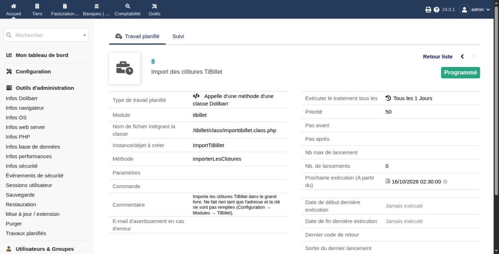

⚠️ **Une tâche programmée ne tourne pas toute seule.** Il faut que le serveur réveille
Dolibarr régulièrement (le « cron » du système). Trois conditions :

1. Le module **Travaux planifiés** est actif (il s'active avec TiBillet).
2. Le serveur lance régulièrement la commande de Dolibarr
   `scripts/cron/cron_run_jobs.php`, avec une **clé de sécurité** et un utilisateur
   (`firstadmin` = le premier administrateur). La commande exacte est donnée par
   Dolibarr : **Configuration → Modules / Applications → Travaux planifiés → roue
   dentée**.
3. Cette clé est la même que le réglage **« Clé de sécurité pour l'URL de lancement des
   travaux programmés »** de la même page. Si elles diffèrent, rien ne tourne.

- 🏠 Si Dolibarr est chez un hébergeur : envoyez-lui ce paragraphe.
- 🐳 Avec l'image Docker officielle de Dolibarr : un conteneur avec `DOLI_CRON=1`,
  `DOLI_CRON_KEY` = la clé de sécurité ci-dessus, et `DOLI_CRON_USER=firstadmin`.
- ✅ Le lendemain, la fiche de la tâche montre la date de sa dernière exécution.

**Rien n'arrive le matin ?** Regardez la fiche de la tâche. « Jamais exécuté » : le
cron du serveur ne tourne pas, ou sa clé est fausse. Un message d'erreur : il dit quoi
corriger. Pas de vente la veille : pas de journée, donc rien à importer (c'est normal).

## 8. Mettre à jour le module

Téléchargez le nouveau zip, envoyez-le comme à l'étape 5.2, puis désactivez et
réactivez le module. Vos réglages et ce qui est déjà importé sont gardés.

## 9. Et ensuite ?

Le module est prêt. La suite dépend de votre mode :

- 🧾 **Les articles et les ventes** : guide
  [Remontée des ventes et articles](03-articles-et-ventes.md) ;
- 📚 **Les écritures comptables** : guide
  [Comptabilité (partie double)](02-relier-tibillet-a-dolibarr.md).
