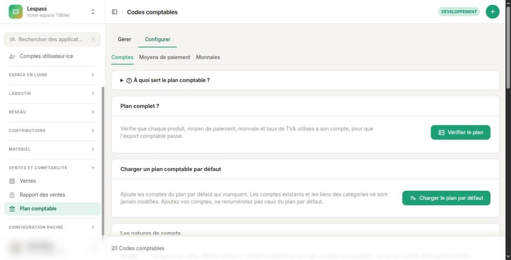
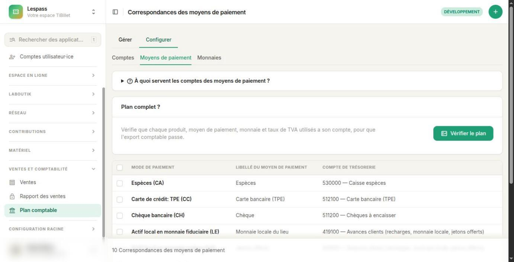
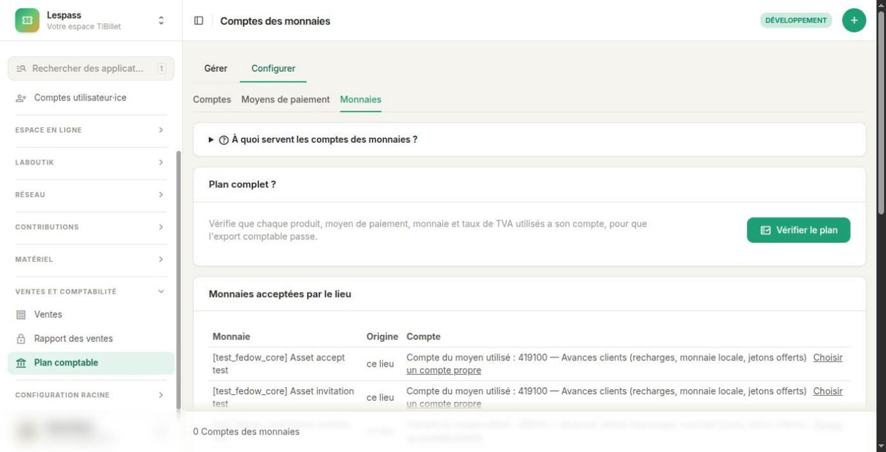
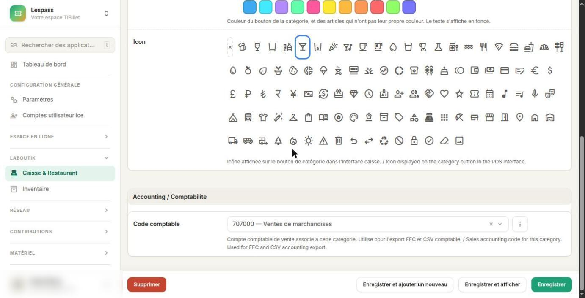
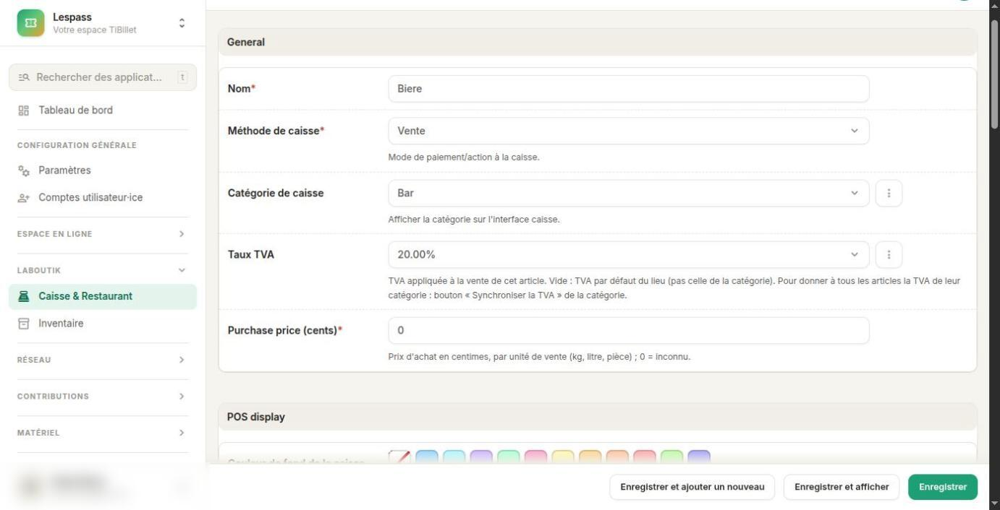
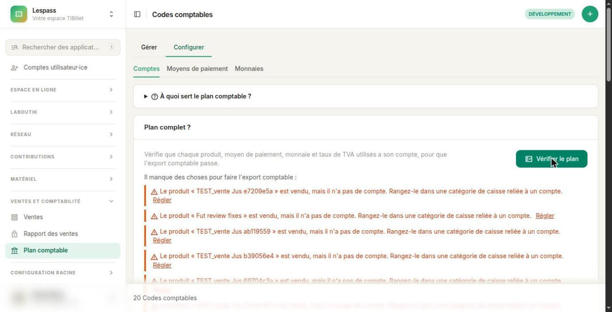
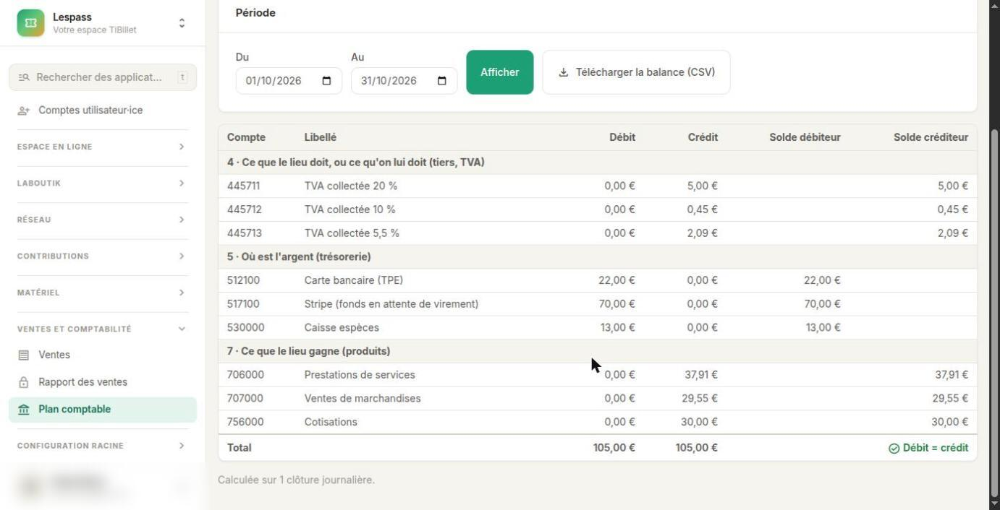
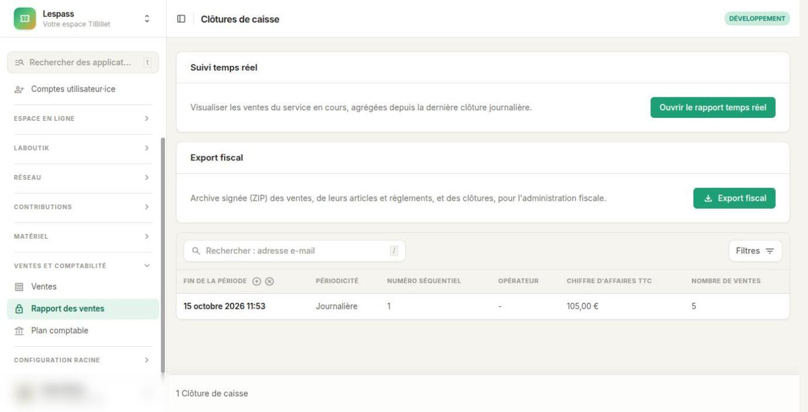
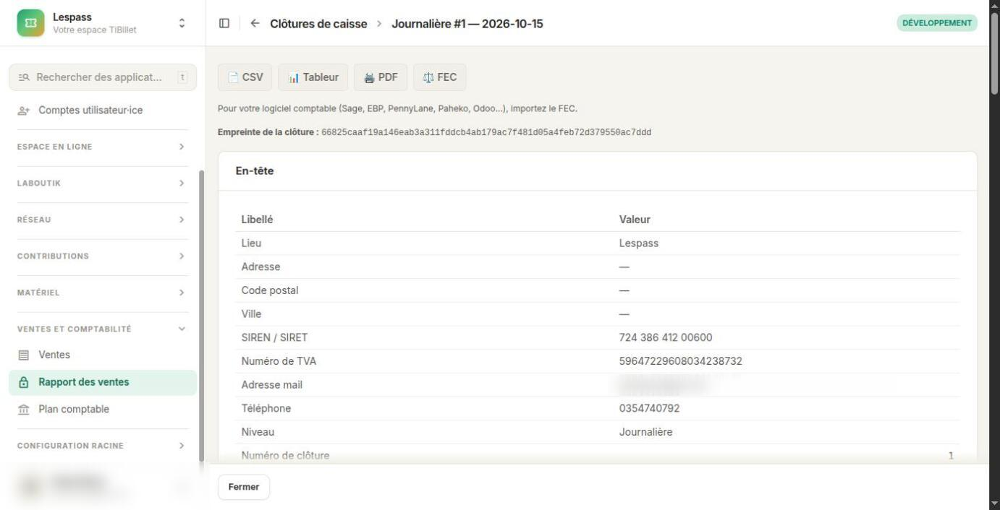

# Un plan comptable

Ce guide est pour les bénévoles, les trésorières et les trésoriers d'un lieu qui utilise
**TiBillet**. Pas besoin d'être comptable : on explique les mots un par un.

À la fin, vous saurez : ce qu'est un plan comptable ; où il se trouve dans TiBillet ;
comment vérifier que tout est prêt pour votre comptable ou pour votre logiciel
comptable.

## 1. Un plan comptable, c'est quoi ?

Imaginez une grande armoire avec des tiroirs. Chaque tiroir a un **numéro** et un
**nom**. Par exemple, le tiroir **530000** s'appelle « Caisse ». Le tiroir **707000**
s'appelle « Ventes de marchandises ».

Chaque euro qui passe dans votre lieu est rangé dans un tiroir. Cette armoire, c'est le
**plan comptable**. Un tiroir, c'est un **compte**. Tous les lieux de France utilisent
presque les mêmes numéros : votre comptable s'y retrouve tout de suite.

### Les tiroirs les plus utilisés dans TiBillet

- 💶 **530000 — Caisse** : les espèces.
- 💳 **512100 — Carte bancaire** : les paiements au terminal de carte (TPE).
- 🌐 **517100 — Stripe** : les paiements en ligne.
- 🍺 **707000 — Ventes de marchandises** : ce que vous vendez au bar (bière, soda, chips…).
- 🎫 **706000 — Prestations de services** : les billets (concerts, spectacles…).
- 🤝 **756000 — Cotisations** : les adhésions.
- 🏛️ **445711, 445712, 445713** : la TVA à 20 %, à 10 %, à 5,5 %. Cet argent n'est pas à
  vous : vous le reversez à l'État.
- 📲 **419100 — Avances des clients** : l'argent chargé sur les cartes cashless. Il
  appartient encore au client tant qu'il ne l'a pas dépensé.

## 2. Pourquoi TiBillet range l'argent dans des tiroirs ?

Chaque soir, TiBillet fait la **clôture de la journée**. On dit aussi le « Z ». TiBillet
regarde toutes les ventes du jour : la caisse, la billetterie en ligne, les adhésions.
Puis il écrit dans quels tiroirs va l'argent.

Ce qu'il écrit s'appelle une **écriture comptable**. Votre comptable, ou votre logiciel
comptable, la reprend telle quelle. Personne n'a besoin de tout recopier à la main.

### Gauche et droite : le débit et le crédit

Une écriture a toujours deux côtés.

- ⬅️ **À gauche, le débit** : où est l'argent maintenant. Par exemple : dans la caisse,
  ou à la banque.
- ➡️ **À droite, le crédit** : pourquoi on a reçu cet argent. Par exemple : une vente,
  une cotisation, ou de la TVA à reverser.
- ⚖️ Les deux côtés font toujours **le même total**. Sinon, il y a une erreur. TiBillet
  le vérifie tout seul.

### Un exemple : une soirée au bar

Hier soir, le bar a vendu des bières, un coca, du vin et des chips. Total : **35 €**. On
a reçu 13 € en espèces et 22 € par carte bancaire.

| Côté | Compte | Montant |
|---|---|---|
| ⬅️ À gauche | 530000 Caisse | 13,00 € |
| ⬅️ À gauche | 512100 Carte bancaire | 22,00 € |
| ➡️ À droite | 707000 Ventes de marchandises | 29,55 € |
| ➡️ À droite | 445711 TVA à 20 % (l'alcool) | 5,00 € |
| ➡️ À droite | 445712 TVA à 10 % (le reste) | 0,45 € |

✅ À gauche : 35 €. À droite : 35 €. L'écriture est juste.

## 3. Où trouver le plan comptable dans TiBillet

Connectez-vous à l'administration de votre lieu. Dans la barre de gauche, ouvrez
**Ventes et comptabilité**, puis **Plan comptable**.

L'écran a deux onglets : **Configurer** (vos comptes) et **Gérer** (la balance, voir
l'étape 2 plus bas). L'onglet **Configurer** a trois sous-onglets.

🗄️ **Comptes** : la liste de tous vos tiroirs, rangés par famille : ventes, TVA,
trésorerie, tiers, charges. En haut : le cadre **« Plan complet ? »** et le bouton
**« Charger le plan par défaut »**.

💳 **Moyens de paiement** : pour chaque façon de payer, le tiroir où va l'argent.
Espèces → 530000. Carte bancaire → 512100. Stripe → 517100.

🪙 **Monnaies** : pour chaque monnaie acceptée par votre lieu (monnaie locale, jetons…),
son tiroir. Si vous ne choisissez rien, une monnaie de votre lieu prend le compte de son
moyen de paiement.

### Le plan par défaut

Vous n'avez rien à créer : TiBillet installe un **plan par défaut** dans chaque lieu. Il
suffit pour la plupart des associations.

Le bouton **« Charger le plan par défaut »** remet les comptes qui manquent. Il n'efface
rien et ne modifie aucun compte.

⚠️ **Une règle importante** : vous pouvez **ajouter** des comptes. Mais ne **changez pas
les numéros** des comptes du plan par défaut : TiBillet les retrouve grâce à leur
numéro.

## 4. Comment TiBillet choisit le bon tiroir

Pour chaque vente, TiBillet se pose trois questions.

### Question 1 : qu'est-ce qu'on a vendu ?

TiBillet regarde la **catégorie de caisse** du produit. Chaque catégorie peut être
reliée à un compte : champ **« Code comptable »**, en bas de la fiche de la catégorie
(**LaBoutik → Caisse & Restaurant → Catégories de produits**). Par exemple : la
catégorie « Bar » est reliée à **707000**.

Si la catégorie n'a pas de compte, TiBillet regarde le type du produit : un **billet**
va dans 706000, une **adhésion** dans 756000, une **recharge** de carte dans 419100.

👉 Pour envoyer un produit dans un autre tiroir : rangez-le dans une catégorie reliée à
ce tiroir.

### Question 2 : quelle TVA ?

TiBillet prend le **taux de TVA du produit** : champ **« Taux TVA »** de la fiche du
produit (**LaBoutik → Caisse & Restaurant → Produits**). Puis il range la TVA dans le
compte de ce taux : 445711 pour 20 %, 445712 pour 10 %, 445713 pour 5,5 %.

⚠️ Attention : si ce champ est vide, TiBillet prend le taux par défaut du lieu, **pas
celui de la catégorie**.

💡 Pour aller vite : choisissez le **« Taux de TVA par défaut »** d'une catégorie, puis
cliquez sur **« Synchroniser la TVA (… %) sur tous les articles »**. Tous les produits
de la catégorie prennent ce taux. Les ventes déjà faites gardent leur TVA.

🔎 Pour vous repérer : l'alcool est à 20 %. Les boissons sans alcool et la nourriture
servies sur place sont à 10 %. Les billets de spectacle sont à 5,5 %. Une adhésion n'a
pas de TVA. En cas de doute, demandez à votre comptable.

### Question 3 : comment le client a-t-il payé ?

TiBillet regarde le **moyen de paiement**, et prend son compte dans le sous-onglet
**Moyens de paiement**. Pour une monnaie locale ou des jetons : dans le sous-onglet
**Monnaies**.

### Et les journaux ?

Un **journal**, c'est un cahier où l'on écrit les opérations d'un même endroit. TiBillet
ouvre un journal par **point de vente** : BAR, RESTAURANT… Les ventes en ligne (billets,
adhésions) vont dans le journal **WEB**.

Le code du journal vient du nom du point de vente : en majuscules, sans accent,
10 lettres au plus.

⚠️ Deux points de vente ne doivent pas avoir le même code (« Bar 1 » et « Bar 2 »
donnent tous les deux BAR). Dans ce cas, donnez un code journal à chacun, sur la fiche
du point de vente.

## 5. Vérifier que tout fonctionne

Faites ces trois vérifications une première fois. Refaites-les après chaque changement :
un nouveau produit, une nouvelle catégorie, un nouveau point de vente.

### Étape 1 : le bouton « Vérifier le plan »

Ouvrez **Plan comptable** (onglet **Configurer**). Dans le cadre **« Plan complet ? »**,
cliquez sur **« Vérifier le plan »**.

- ✅ Un message vert dit que tout va bien.
- 🟠 Ou bien une liste dit ce qui manque. Chaque phrase a un lien **« Régler »** qui
  ouvre le bon écran. Sur l'image ci-dessous : des produits ont été vendus, mais ils ne
  sont rangés dans aucune catégorie reliée à un compte. Il faut les ranger, puis
  cliquer à nouveau sur « Vérifier le plan ».

### Étape 2 : la balance des comptes

Dans **Plan comptable**, ouvrez l'onglet **Gérer** : c'est la **balance des comptes**.
Elle montre le total de chaque tiroir sur une période (le mois en cours, au départ).
Changez les dates, puis cliquez sur **Afficher**.

- ✅ En bas du tableau : **« Débit = crédit »** en vert.
- 💡 Gardez cette page sous la main : vous comparerez ces chiffres avec ceux de votre
  logiciel comptable. Ils doivent être exactement les mêmes.

### Étape 3 : le fichier FEC d'une journée

Le **FEC** (Fichier des Écritures Comptables) est le fichier officiel de vos écritures.
Tous les logiciels comptables savent le lire.

Ouvrez **Ventes et comptabilité → Rapport des ventes**. Cliquez sur une clôture
**Journalière**, puis sur le bouton **FEC**.

- ✅ Le fichier se télécharge : c'est gagné.
- 🔴 Un message rouge apparaît : il dit ce qui manque. Corrigez, puis recommencez.
  TiBillet refuse toujours de produire un fichier faux.

## 6. Les messages d'erreur, et quoi faire

| Le message dit… | Que faire |
|---|---|
| « Le produit … est vendu, mais il n'a pas de compte » | Rangez le produit dans une catégorie de caisse reliée à un compte. |
| « Le moyen de paiement … est utilisé, mais il n'a pas de compte » | Sous-onglet **Moyens de paiement** : choisissez un compte pour ce moyen. |
| « La monnaie … est utilisée, mais elle n'a pas de compte » | Sous-onglet **Monnaies** : choisissez le compte de cette monnaie. |
| « Des ventes ont une TVA à … %, mais le plan n'a pas de compte de TVA à ce taux » | Ajoutez un compte de TVA à ce taux dans le plan comptable. |
| « Le compte … du plan par défaut manque » | Cliquez sur « Charger le plan par défaut ». |
| « Les points de vente … ont le même code journal » | Sur la fiche de chaque point de vente, donnez un code journal différent. |
| « … règlements sont au compte d'attente (471000) » | Des paiements ont un moyen inconnu. Le lien montre les ventes concernées : corrigez leur moyen de paiement. |
| « Une écriture n'est pas équilibrée » | Ne touchez à rien. Prévenez la coopérative TiBillet : c'est le signe d'une donnée modifiée à la main. |

## 7. Et ensuite ?

Votre plan est complet ? Vous pouvez envoyer vos écritures à votre comptable (le fichier
FEC), ou à un logiciel comptable.

Pour **Dolibarr**, TiBillet a un module qui fait tout seul, chaque matin : voir le guide
[Le module TiBillet](00-installer-le-module.md).
