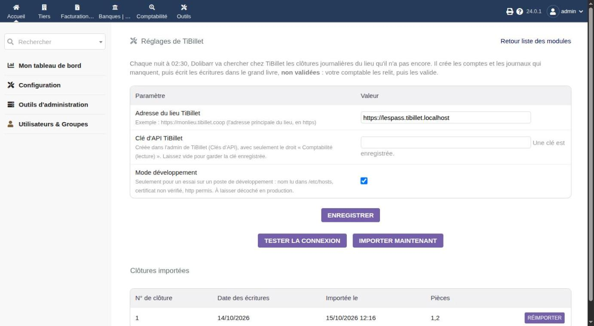
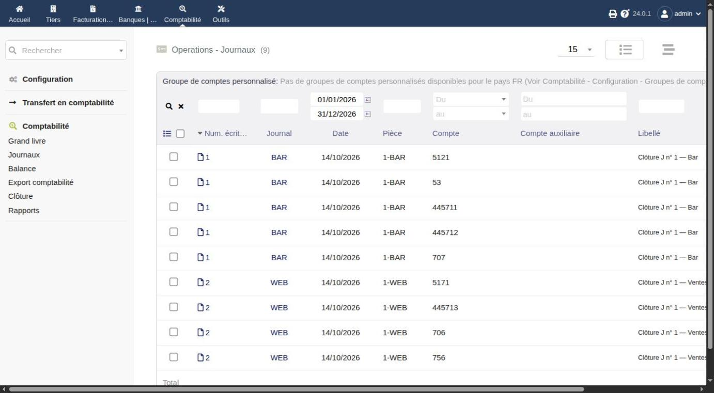
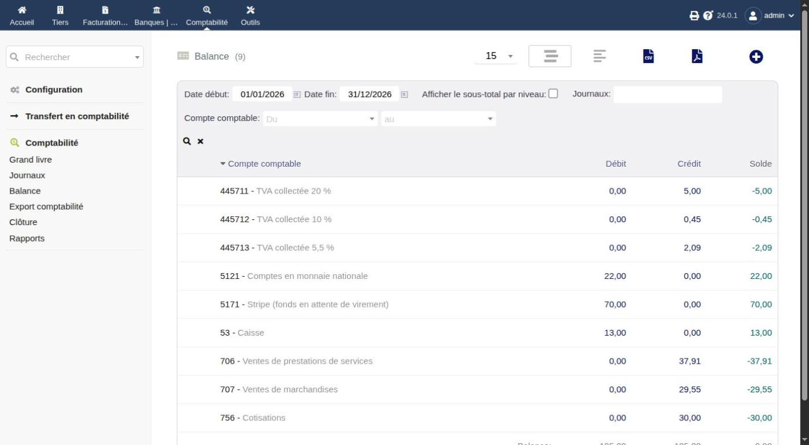

# Comptabilité (partie double) : les écritures comptables de TiBillet

Ce guide décrit le mode « **Les écritures comptables** » du module TiBillet pour
Dolibarr : vos écritures comptables arrivent toutes seules dans le grand livre de
Dolibarr, chaque matin. Pas besoin d'être informaticien : on avance pas à pas, avec des
images.

📖 Avant de commencer :
- le guide [Un plan comptable](01-un-plan-comptable.md) explique les mots « compte »,
  « journal », « débit » et « crédit » ;
- le guide [Le module TiBillet](00-installer-le-module.md) installe et règle le module.
  Pour ce mode : la clé n'a que le droit **« Comptabilité (lecture) »**, et vous cochez
  « **Les écritures comptables** » dans les réglages du module.

Pour que Dolibarr tienne la comptabilité avec ses propres factures, voir plutôt le guide
[Remontée des ventes et articles](03-articles-et-ventes.md).

## 1. Ce que fait ce mode, en clair

- 🕕 **Chaque matin, à 6 h** (heure réglable), Dolibarr demande à TiBillet : « As-tu de
  nouvelles journées clôturées ? »
- 📦 TiBillet répond avec les **écritures** de ces journées. Ce sont exactement les mêmes
  que dans le fichier FEC.
- 📚 Dolibarr les range dans son **grand livre** (le grand cahier de toutes les
  écritures), **non validées**. Votre comptable les relit, puis les valide.
- 🧰 S'il manque un compte ou un journal dans Dolibarr, le module **le crée**. Il ne
  modifie **jamais** un compte qui existe déjà.
- 🧱 Une journée arrive **en entier, ou pas du tout**. Elle n'arrive **jamais deux fois**.
- 🛑 Si TiBillet refuse une journée (par exemple : un produit sans compte), l'import
  s'arrête et le dit. Le lendemain, il reprend au même endroit.

### Le chemin de l'argent, du bar jusqu'au comptable

1. **Les ventes** : la caisse du bar, la billetterie en ligne, les adhésions.
2. **La clôture de la journée** (le « Z »), dans TiBillet : les ventes sont rangées dans
   les comptes.
3. **L'API de TiBillet** : une porte qui ne s'ouvre qu'avec une **clé**. Cette clé
   permet seulement de **lire** la comptabilité.
4. **Le module TiBillet**, dans Dolibarr : chaque matin, il passe la porte avec la clé
   et copie les écritures.
5. **Le grand livre de Dolibarr** : les écritures arrivent non validées.
6. **Votre comptable** relit et valide.

### Ce que ce mode ne fait pas

- ❌ Il ne crée pas de factures, ni de fiches clients, ni de PDF.
- ❌ Il ne modifie rien dans TiBillet : la clé ne sert qu'à lire.
- ❌ Il n'importe pas les journées d'avant la mise en service de la comptabilité de
  TiBillet. Pour cette période, utilisez les rapports mensuels.

## 2. Premier import

Pas besoin d'attendre le matin : sur la page du module, cliquez sur
**Importer maintenant**.

En bas de la page, le tableau **« Clôtures importées »** montre chaque journée arrivée :
son numéro TiBillet, la date de ses écritures, le jour de l'import, et ses **pièces**
(une pièce par journal : BAR, WEB…).

💡 Si un message dit que TiBillet a refusé une journée (un compte manque), corrigez le
plan comptable dans TiBillet (voir le guide [Un plan comptable](01-un-plan-comptable.md)),
puis cliquez de nouveau sur Importer maintenant.

## 3. Vérifier dans Dolibarr

**Les écritures** : menu **Comptabilité → Comptabilité → Journaux** (ou
**Grand livre**). Chaque ligne a son journal (BAR, WEB…), sa date, sa pièce (« 1-BAR » :
clôture n° 1, journal BAR) et son compte.

**La balance** : menu **Comptabilité → Comptabilité → Balance**. Comparez-la avec la
balance de TiBillet (Plan comptable, onglet Gérer) sur la même période.
✅ Les montants doivent être **exactement les mêmes**.

💡 Dolibarr écrit les numéros de compte **sans les zéros de droite** : 707000 devient
707, 512100 devient 5121, 530000 devient 53. C'est le même compte.

Les écritures arrivent **non validées** : votre comptable les relit, puis les valide
dans Dolibarr. Une journée dont une ligne est validée ne peut plus être réimportée (voir
l'étape 4).

## 4. Réimporter une journée

Vous avez changé un compte dans TiBillet après l'import (par exemple : une catégorie
reliée à un autre compte) ? Dans les réglages du module, le bouton **Réimporter** d'une
journée retire ses écritures de Dolibarr et les réécrit avec le plan comptable actuel de
TiBillet.

🔒 C'est impossible si une ligne de cette journée est déjà validée par votre comptable :
la comptabilité validée ne bouge plus.

## 5. Questions fréquentes

**Rien n'arrive le matin. Pourquoi ?**
Voir le guide [Le module TiBillet](00-installer-le-module.md), étape 7 : la tâche de
chaque matin.

**Pourquoi les journaux sont-ils de nature « Opérations diverses » ?**
Les écritures arrivent déjà calculées et équilibrées par TiBillet. Dolibarr ne doit pas
les recalculer comme ses propres ventes.

**Est-ce que Dolibarr peut modifier TiBillet ?**
Non. La clé ne permet que de lire la comptabilité.

**Où est gardée la clé ?**
Dans la base de Dolibarr, chiffrée. Elle n'est jamais réaffichée.

**Une journée peut-elle arriver deux fois ?**
Non. Le module note chaque journée importée, et vérifie le grand livre avant d'écrire.
