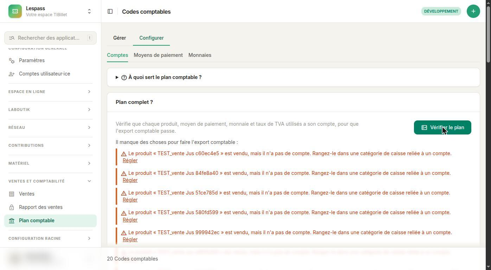
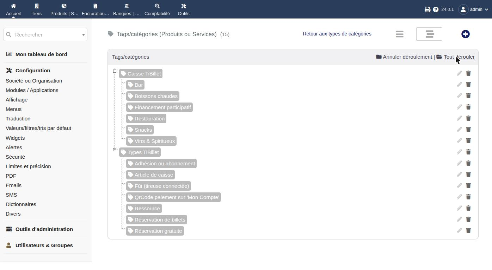
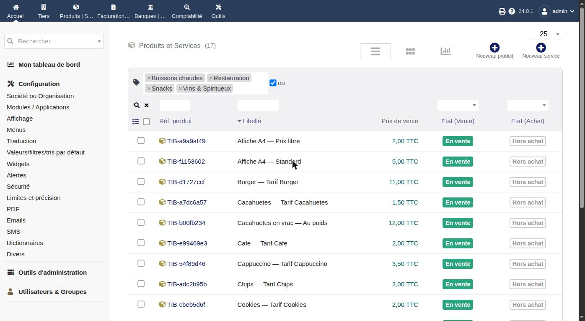
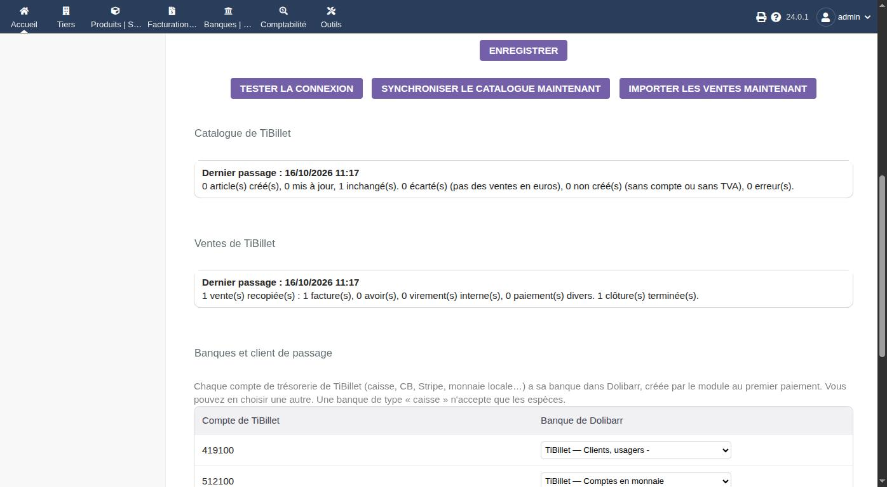
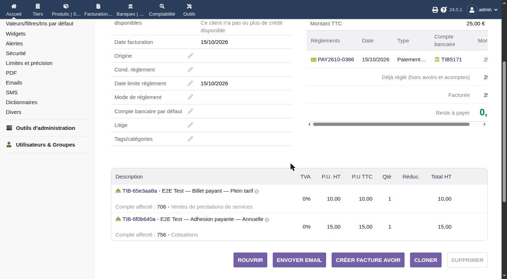
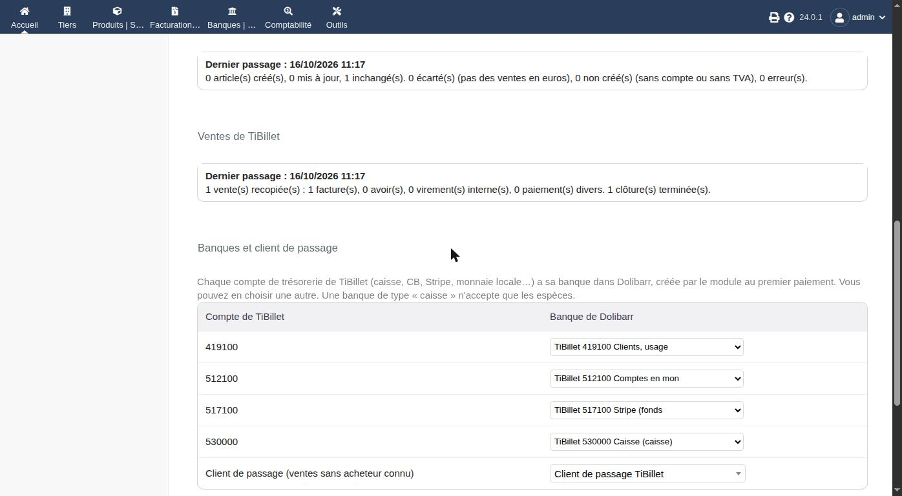
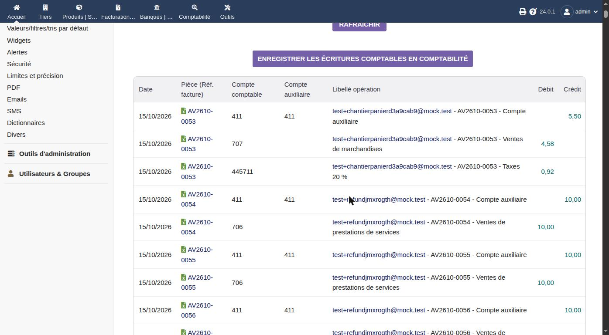
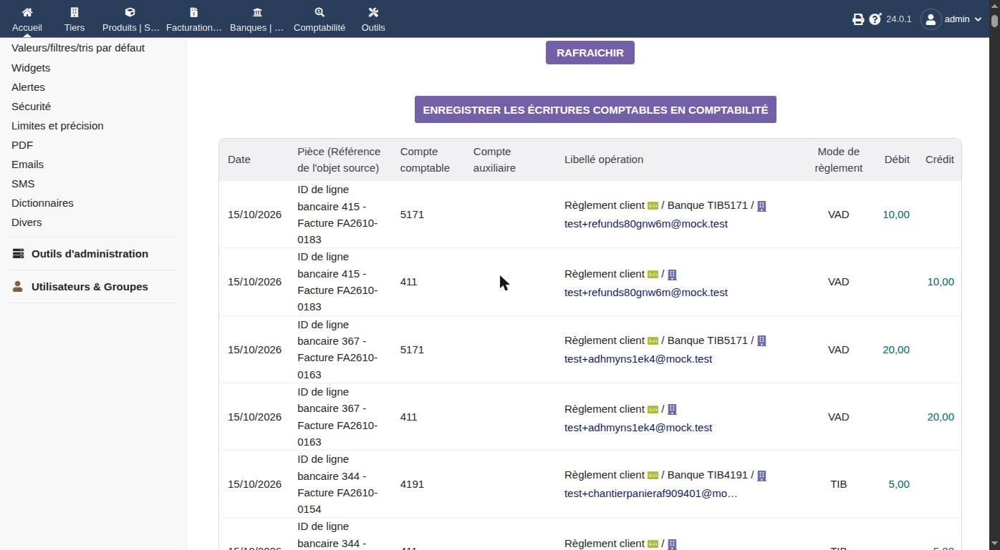

# Remontée des ventes et articles : Dolibarr tient la comptabilité

Ce guide explique le mode **« Les articles et les ventes »** du module TiBillet pour
Dolibarr. C'est le mode **par défaut** d'une nouvelle installation. Pas besoin d'être
informaticien : on avance pas à pas, avec des images.

📖 Avant de commencer :
- [Un plan comptable](01-un-plan-comptable.md) explique les mots « compte », « journal »,
  « débit » et « crédit » ;
- [Le module TiBillet](00-installer-le-module.md) installe et règle le module. Pour ce
  mode : la clé a les droits **« Produits »**, **« Comptabilité (lecture) »** et
  **« Ventes »**, et « **Les articles et les ventes** » est coché dans les réglages
  (c'est le choix par défaut).

## 1. Ce que fait ce mode, en clair

TiBillet vend : la billetterie, les adhésions, les ressources, le bar et la tireuse.
Dolibarr **tient la comptabilité** avec ses propres factures. TiBillet n'est plus qu'un
« front » de vente.

- 🕕 **Chaque matin, à 6 h** (heure réglable), Dolibarr demande à TiBillet ce qui a
  changé. Jamais en temps réel : il ne lit que les **journées déjà clôturées** (le
  « Z » du soir).
- 📦 D'abord le **catalogue** : un produit Dolibarr par tarif vendu en euros
  (« Bière — Pinte »), avec son prix, sa TVA et son compte de vente.
- 🧾 Ensuite les **ventes** de chaque journée clôturée :
  - **une facture payée par vente** (un **avoir** pour un remboursement) ;
  - au nom de **l'acheteur**, retrouvé par son **e-mail** (créé s'il n'existe pas),
    ou du **client de passage** pour une vente au bar sans acheteur connu, comme la
    caisse de Dolibarr ;
  - le **paiement** va dans la bonne **banque** : caisse (espèces), CB, Stripe, monnaie
    locale…
- 🔁 Une **recharge** de carte cashless n'est pas une vente : c'est un **virement
  interne** (l'argent passe de la banque « monnaie locale » à la caisse ou à la CB).
  Un **vidage** de carte, c'est l'inverse.
- 🎁 La **recharge offerte**, les **jetons cadeau repris** et les petits **écarts
  d'encaissement** (Stripe, QR, tireuse) sont des **paiements divers**.
- ⚖️ Compte par compte, le résultat est **exactement** celui du fichier FEC de TiBillet.
- 🧱 Une vente arrive **en entier, une seule fois**. Si une vente est refusée, l'import
  s'arrête et le dit ; le lendemain, il reprend à cette vente.

> ⚠️ **Un seul mode à la fois.** Le mode « Les écritures comptables » range
> les journées dans le grand livre ; ce mode-ci les range en factures. Jamais les deux :
> chaque vente serait comptée deux fois. Une journée importée dans un mode ne l'est
> jamais dans l'autre.

## 2. Côté TiBillet : chaque article a un compte

Dolibarr range chaque vente dans le compte que TiBillet lui donne. Un article de caisse
prend le compte de sa **catégorie de caisse** ; un billet ou une adhésion, celui de son
type. Un article sans compte bloque la journée.

Dans l'admin de TiBillet : **Ventes et comptabilité → Plan comptable → Configurer →
« Plan complet ? » → Vérifier le plan**. Rien ne doit manquer. Si un article vendu n'a
pas de compte, la page le dit et le lien **Régler** ouvre l'article : rangez-le dans une
catégorie de caisse reliée à un compte.

## 3. Tester la connexion : Dolibarr se prépare

Sur la page du module, cliquez **Tester la connexion**. Le module vérifie les trois
droits de la clé, puis
**prépare Dolibarr** et dit ce qu'il a fait :

- il active les **modes de paiement** dont il a besoin (`VAD` pour Stripe) et crée
  un mode par type de monnaie : monnaie locale (`TIBL`), monnaie cadeau (`TIBG`),
  FED (`TIBF`), et `TIB` pour tout autre moyen ;
- il crée le **client de passage** ;
- il vérifie que chaque **compte de trésorerie** de TiBillet a sa **banque** dans
  Dolibarr (voir « Les banques » plus bas).

S'il manque quelque chose qu'il ne doit pas régler à votre place (une option de
Dolibarr, un droit), il le **dit** et l'import ne démarre pas tant que ce n'est pas
corrigé.

Les messages de réussite s'effacent au bout de quelques secondes ; un manque, lui, reste
affiché.

## 4. Le catalogue

Cliquez **Synchroniser le catalogue maintenant**. Les produits TiBillet arrivent, rangés
sous deux catégories : **Caisse TiBillet** (vos catégories de caisse) et **Types
TiBillet** (billets, adhésions…). Une catégorie que vous ajoutez à la main reste.

## 5. Les ventes

Cliquez **Importer les ventes maintenant** (ou attendez le matin). Le résumé dit combien
de ventes, de factures, d'avoirs, de virements et de paiements divers sont arrivés.

Une facture importée est **payée**, à la date de la journée. Son compte de vente est
celui du **produit** (fiche produit → onglet Comptabilité).

### Les banques et le client de passage

Chaque compte de trésorerie de TiBillet (caisse 530000, CB 512100, Stripe 517100,
monnaie locale 419100…) doit avoir sa **banque** dans Dolibarr. Le module retient la
banque qui porte **le même numéro** de compte comptable : les zéros de droite ne
comptent pas, 530000, 5300 et 53 sont le même compte. **Il ne crée aucune banque.**

S'il en manque une, **Tester la connexion**, **Synchroniser le catalogue** et
**Importer les ventes** s'arrêtent et nomment le compte. Deux façons de régler :

- créer la banque dans Dolibarr (Banque / Caisse → Nouveau compte), avec ce numéro
  dans « Compte comptable » ;
- ou la relier à une banque existante sur la page du module, section **Banques et
  client de passage**. Le tableau montre chaque compte de TiBillet, avec son libellé,
  et la banque retenue ; « — à relier — » signale un compte sans banque.

Une banque de type **caisse** n'accepte que les espèces : la page refuse de la choisir
pour un autre compte que 53.

## 6. La comptabilité dans Dolibarr

Ce mode **ne touche pas** à la comptabilité de Dolibarr : ni plan comptable, ni comptes
généraux, ni journaux. Le module « Comptabilité (partie double) » peut rester éteint.

Si vous l'utilisez quand même, c'est vous qui réglez la comptabilité de Dolibarr : plan
comptable, comptes généraux (client 411, fournisseur 401, TVA, virements internes 58),
journaux. Puis :

1. **Comptabilité → Liaison → Ventes clients** : **Lier automatiquement**. Chaque ligne
   prend le compte de vente de son produit. Une ligne sans produit (tarif absent du
   catalogue) se lie à la main.
2. **Comptabilité → Journaux** : vérifiez, puis cliquez **Enregistrer les écritures
   comptables en comptabilité**.

## 7. Questions fréquentes

**Une vente est refusée.** Le résumé de la page donne son numéro et la raison (le plus
souvent : un article sans compte, voir §2). Corrigez dans TiBillet ; le lendemain,
l'import reprend à cette vente. Les ventes suivantes attendent : les numéros de facture
suivent l'ordre des ventes.

**Un acheteur a deux fiches.** Le module retrouve le tiers par son **e-mail**. S'il y en
a plusieurs avec le même e-mail, il prend le plus ancien. Un acheteur qui change
d'e-mail dans TiBillet aura une nouvelle fiche.

**Le solde de la banque « monnaie locale » est négatif.** C'est normal : il vaut, en
négatif, la monnaie encore sur les cartes de vos clients (ce que vous leur devez).

**Je veux revenir au mode « écritures ».** Possible, la page vous prévient. Les journées
déjà importées en factures ne passeront jamais dans le grand livre, et l'inverse.

**« Réimporter » n'apparaît pas sur une journée.** Une journée importée en factures ne se
réimporte pas en écritures : elle serait comptée deux fois.

**Combien de ventes par nuit ?** Toutes : le module lit les ventes page après page,
jusqu'à la dernière. Une journée de 300 ventes prend quelques secondes. Si votre
serveur coupe PHP trop tôt, la constante `TIBILLET_VENTES_PAR_PASSAGE` limite le
nombre de ventes par passage : la suite arrive au passage suivant.
